# História de Projetos

## Justificativa

A história da diretoria de Projetos é um relato essencial para entender sua evolução, desafios superados, conquistas ao longo do tempo e, principalmente, desenvolver nossa identidade. Essa iniciativa busca resgatar e documentar a trajetória da diretoria, desde sua criação, destacando as principais transformações, dificuldades enfrentadas e as soluções que permitiram sua evolução, com o objetivo de fortalecer a identidade e guiar as práticas adotadas no futuro.

## Objetivos

-   **Resgatar a história da diretoria**: documentar a criação, evolução e marcos importantes da diretoria de projetos, destacando suas conquistas e aprendizados ao longo dos anos.
-   **Compartilhar as conquistas e desafios**: refletir sobre as vitórias e as dificuldades enfrentadas, para que a história sirva como fonte de inspiração e aprendizado para os membros atuais e futuros.
-   **Fortalecer a identidade da diretoria**: criar um vínculo maior entre os membros, reforçando o propósito e os valores da diretoria ao longo de sua trajetória.
-   **Disponibilizar a informação**: colocar essa informação em algum site ou expor de forma que fique de fácil acesso para todos os membros.
-   **Ajudar os trainees**: facilitar o entendimento dos trainees sobre a diretoria de projetos e seu posicionamento durante a história da ESTAT.
-   **Criar um hábito de guardar essas lembranças**: gerar uma identidade e senso de pertencimento, tanto para os membros que saíram, os que continuam e os que ainda vão entrar.

## Produto Final

A história da diretoria de projetos se inicia a muito tempo atrás… mas no molde que conhecemos hoje, a história começa em 2022.

## A MUITO TEMPO ATRÁS (Antes de 2022)

Inicialmente, a ESTAT era dividida em dois grandes squads e seis diretorias (até onde temos registro), este organograma é chamado de “antigo organograma” e ele era bem diferente do que temos hoje. Existiam os squads de Gestão e Projetos, subordinados à presidência, cada um com três diretorias: operações, marketing e qualidade, e empresarial, acadêmicos e social, respectivamente. Cada membro da ESTAT fazia parte de duas diretorias, uma de cada squad, e era responsável por vender e gerenciar seus próprios projetos (isso devia dar um trabalho!).

O squad de Gestão dizia muito sobre a vivência empresarial, e (o mais importante pra gente) o de Projetos sobre a execução. Por exemplo, se você fizesse parte da diretoria de empresarial, você só teria contato com projetos de pessoa jurídica, em acadêmicos você ficaria responsável por projetos de TCC, mestrandos, doutorandos, etc. Já social era uma área dedicada a projetos sociais sem fins lucrativos, mas isso não funcionou muito bem nesse final… Nesse sentido, essa “jornada dupla” de diretores vinha causando muita insatisfação e falta de engajamento (já que normalmente se dedicavam mais a uma do que a outra). E nesse período de instabilidade foi decidido: a mudança de organograma.

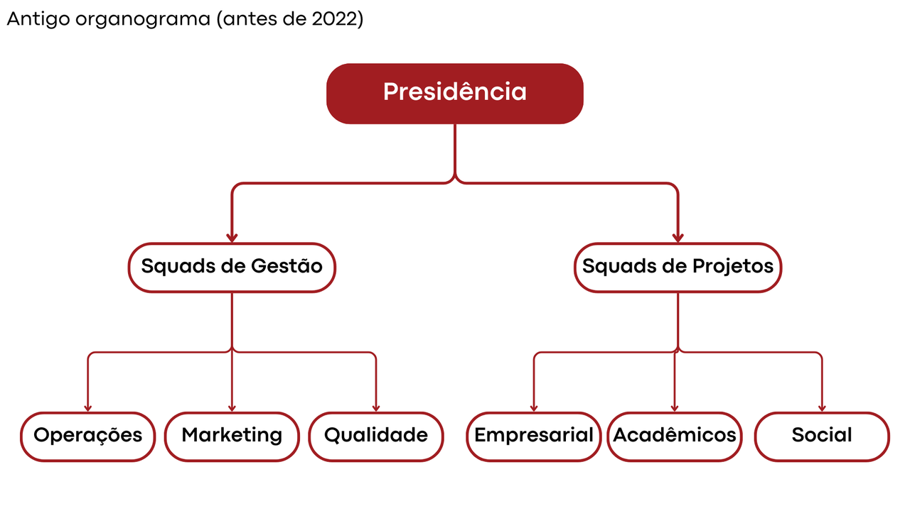

## O NOVO (E QUASE ATUAL) ORGANOGRAMA E O BEBÊ PROJETOS

Como resposta a essa falta de motivação e priorização de tarefas, o novo organograma nasce como um plano otimista para juntar vivência empresarial e execução de projetos de maneira mais harmônica. Agora existiriam três diretorias: Comercial, Projetos e Gestão, especializadas e responsáveis por processos específicos, com diretores que servem como ponte entre os interesses dos membros e a presidência. E TODOS OS MEMBROS EXECUTAM PROJETOS, com a possibilidade da criação de squads, como áreas entre as diretorias, responsáveis por executar demandas específicas que abrangem toda a empresa, como o marketing e inovação.

E é assim que, em 2022.1, nasce o bebê projetos. Nesse sentido, a diretoria de projetos visava reunir pessoas especializadas em gerenciar o projeto e lidar com todas as frentes com que ele se relaciona. Com seus processos e estruturas sendo desenvolvidos a partir do zero! O que foi uma grande responsabilidade, uma vez que as atividades das antigas diretorias de qualidade, empresarial, acadêmicos e social se tornaram o papel desse novo bebê que acabara de nascer.

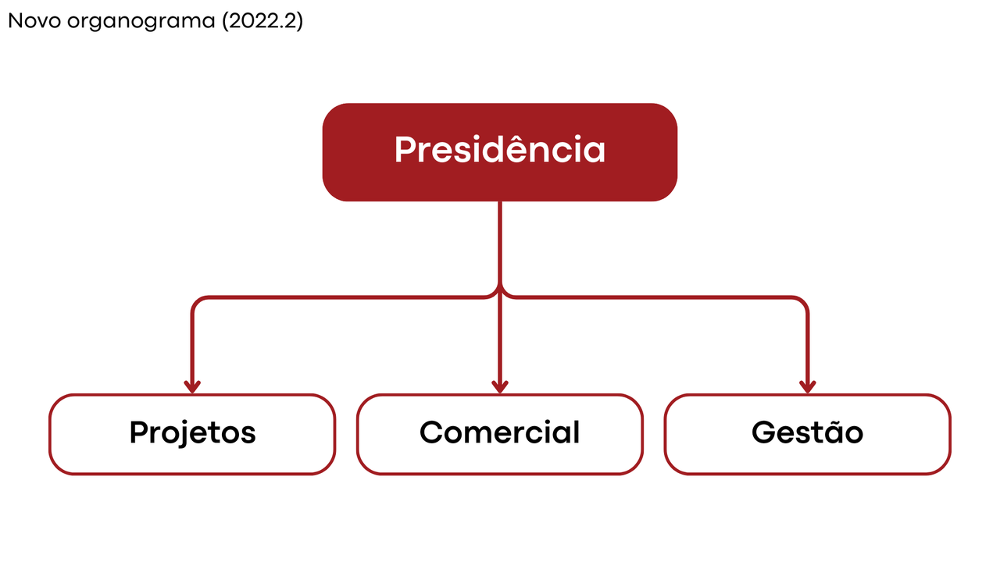

### 0 MESES (2022.1)

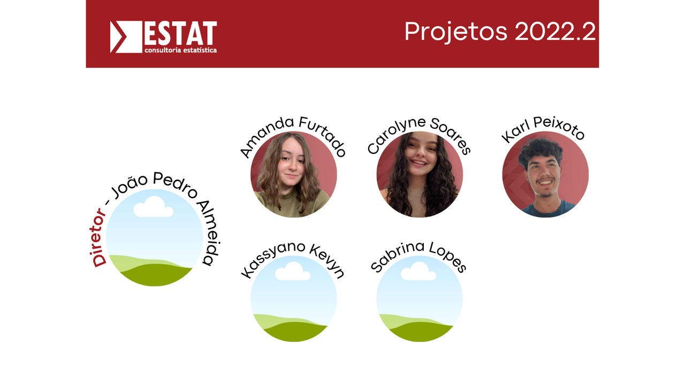

**Diretor**: João Pedro Almeida.\
**Membros**: Amanda Furtado, Carolyne Soares, Karl Peixoto, Kassyano Kevyn e Sabrina Lopes.

### 6 MESES (2022.2)

Esse pequeno não nasceu sem personalidade, agora, como parte da construção da identidade das diretorias, semestralmente somos encarregados de desenvolver nossa identidade e Projetos nasceu como *Mean Girl de Projetos* (2022.2).

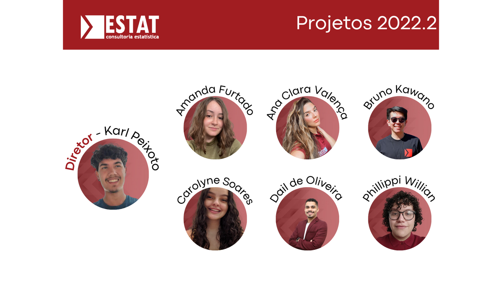
**Diretor**: Karl Peixoto.\
**Membros**: Amanda Furtado, Ana Clara Valença, Bruno Kawano, Carolyne Soares, Dail de Oliveira e Phillippi Willian.

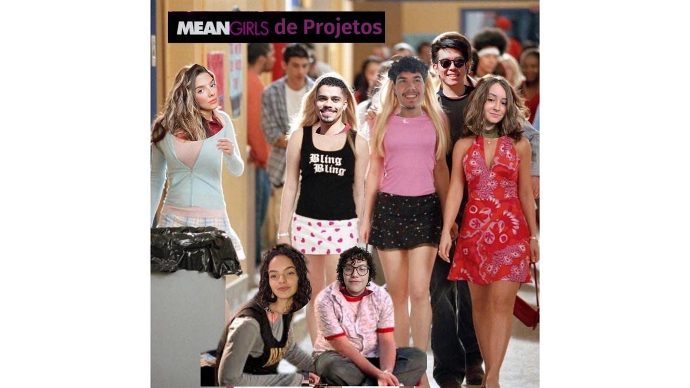

Aqui as meninas chegaram para colocar ordem nessa “escola” e nos permitiram viver Projetos como ele é hoje! Mas nem tudo são flores, e esse período foi marcado pelas seguintes dores: - Grande tensão com o resto da empresa. - Projetos no seu mundinho. - Estruturação de processos. - Comunicação. - Processo Seletivo ruim.

### 1 ANO (2023.1)

Agora, com um ano de idade, o bebê Projetos começou a descobrir o mundo ao seu redor, organizou as ideias e implementou as famosas OKR’s! Com os objetivos chave na cabeça, foram capazes de melhorar a comunicação e relacionamento com o restante da empresa, estruturar o gerenciamento e desenvolver nossa atividade durante o Processo Seletivo. Mas as coisas não estavam muito tranquilas… e a empresa estava sendo atacada por algumas bombas.

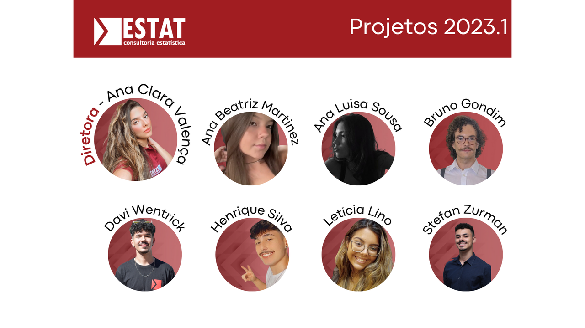
**Diretora**: Ana Clara Valença.\
**Membros**: Ana Beatriz Martinez, Ana Luisa Sousa, Bruno Gondim, Davi Wentrick, Letícia Lino, Henrique Silva e Stefan Zurman.

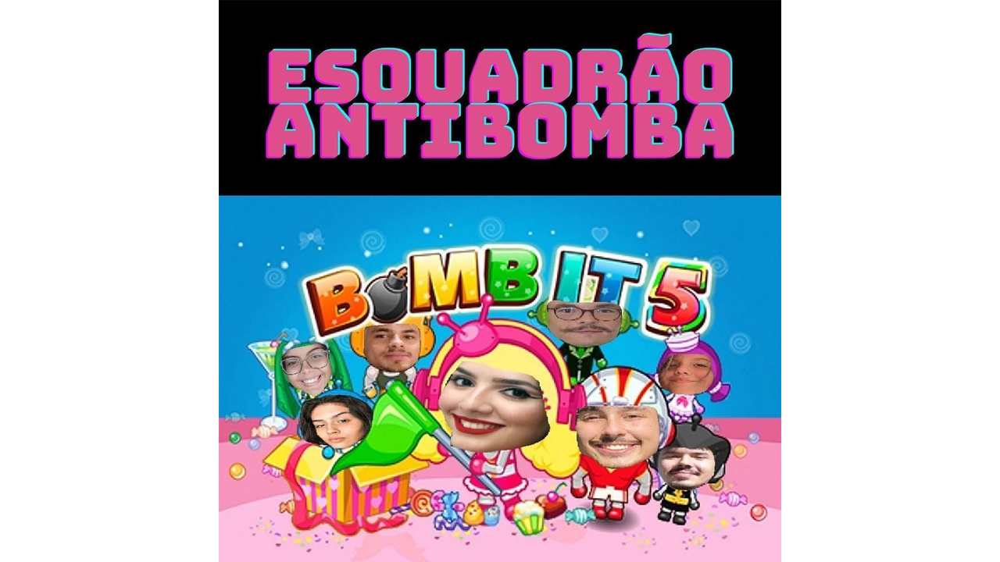

Dessa forma, o Esquadrão Antibombas de Projetos iniciou suas operações para lidar com os desafios vendidos, e essa equipe bem treinada foi capaz de lidar com diversos desafios, mas ainda ficaram alguns fios sem cortar: - Terceirização mal estruturada. - Sobrecarga de membros. - Processos não tão bem definidos e/ou lentos. - Falta de contato com a área de inovação. - Falta de métricas que proporcionem uma visão geral da empresa. - Falta de coleta de NPS. - Falha na contextualização de projetos. - Falha na validação de projetos.

### 1 ANO E 6 MESES (2023.2)

Mais esperto, Projetos começou a caminhar por um mundo novo chamado GitHub, deixando para trás o Gitlab e com isso explorando novos horizontes no versionamento de versões. Agora, se comunicando melhor, estreitou seus laços com Comercial, criando o #validação, iniciou com o documento de contextualização para os alocados e passou a transparecer o farol de alocação para a empresa. Para conseguir fazer tudo isso foi necessário tomar muitos riscos, mas juntos essas fadas conseguem passar por qualquer desafio!

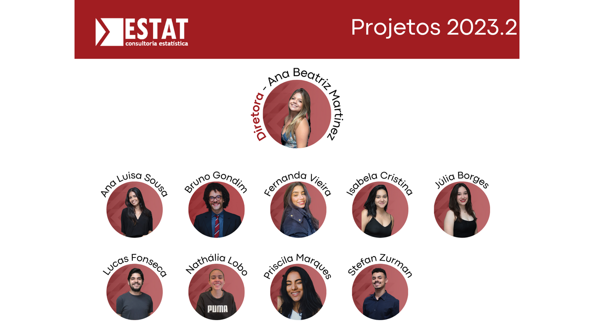

**Diretora**: Ana Beatriz Martinez.\
**Membros**: Ana Luisa Sousa, Bruno Gondim, Fernanda Vieira, Isabela Cristina, Júlia Borges, Lucas Fonseca, Nathália Lobo, Priscila Marques e Stefan Zurman.

Assim, o Clube de Projetos usou toda sua magia para transformar, com muita Qualidade & Excelência a história da ESTAT, mas as Pixies não pararam por nenhum momento e, mesmo com todas essas vitórias, as fadas estavam muito cansadas: - Falta de engajamento do time. - Falta de desenvolvimento de OKR’s. - Sobrecarga. - Relação Comercial - Projetos. - Nenhum controle de métricas. - Pouco controle dos projetos. - Falta de gestão do conhecimento. - Projeto Fantasma insatisfatório.

### 2 ANOS (2024.1)

Expandindo o seu repertório, Projetos aproveitou 2024.1 para rever processos, atualizar o referencial teórico, mudar a estrutura do relatório e planejar um futuro ainda mais brilhante. E tudo fica ainda melhor com a presença de seu novo primo, o Marketing, que ajudaria ele a desenvolver novas habilidades, como a User Experience. Agora, o gerenciamento alcançou novos patamares e com os processos ajustados, restava pensar em uma das dores mais antigas da humanidade: o relacionamento com o cliente, ponto importantíssimo para uma nova ESTAT, que agora é Cluster 5. Dessa forma, Os Faraónicos tiveram que explorar esses antigos segredos.

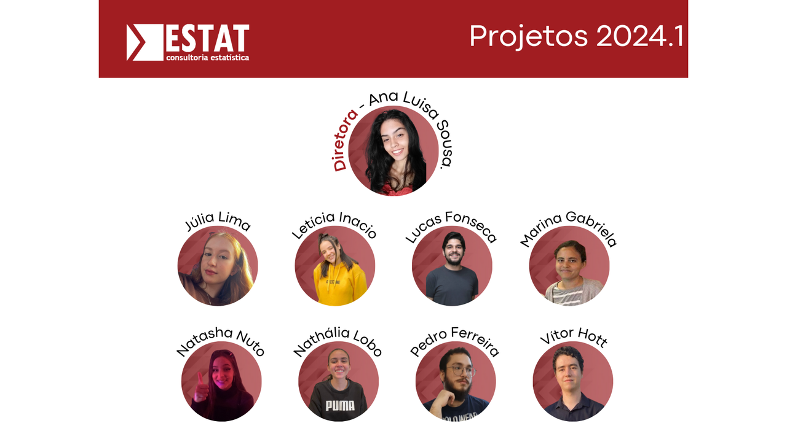

**Diretora**: Ana Luisa Sousa.\
**Membros**: Júlia Lima, Letícia Inacio, Lucas Fonseca, Natasha Nuto, Nathália Lobo, Pedro Ferreira e Vítor Hott.

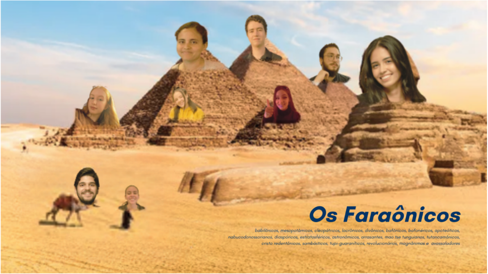

Essa equipe faraônica, babilônica, mesopotâmica, lacrônica, divônica, bafônica, bafonérica, apoteótica, nabucodonossoriana, diaspórica, estratosférica, astronômica, sambástica, revolucionária, magnânima e avassaladora, realmente arrasou com todas as expectativas, mas até mesmo os melhores têm algumas dificuldades e com eles não foi diferente: - Documentação de processos. - Projetos com prazo curto. - Transparência com cliente. - Especialização UX. - Problemas em cima da hora. - Alocação desproporcional.

### 2 ANOS E 6 MESES (2024.2)

Cada vez com mais energia e engajado, Projetos começa a se entender como uma diretoria que precisa implementar novos processos devido às novas demandas de uma ESTAT muito maior e uma diretoria com 13 membros! E para conseguir ter melhor controle e uma visão mais segmentada, foi criada a Coordenadoria de Projetos, inicialmente planejada para três coordenadores, um de qualidade, um de inovação e um de UX. Essa adaptação e com os membros engajados para inovar dentro da diretoria, essa fase foi marcada por muitas mudanças, documentação, novos processos e até mesmo um site. E é claro que para lidar com tudo isso, os bravos guerreiros e os dragões da House of Excellence foram convocados e ordenados a ir para o campo de batalha!

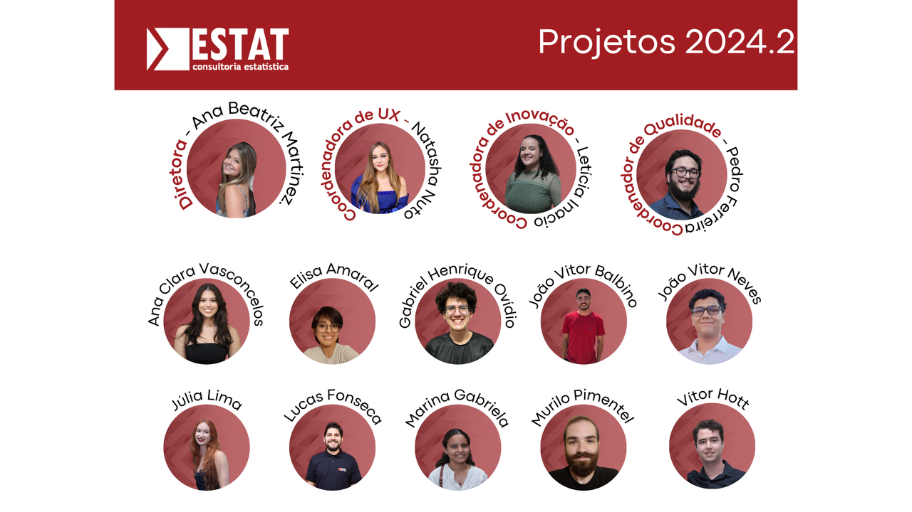

**Diretora**: Ana Beatriz Martinez.\
**Coordenadores**: Natasha Nuto (UX), Pedro Ferreira (Qualidade) e Letícia Inacio (Inovação).\
**Membros**: Ana Clara Vasconcelos, Elisa Amaral, Gabriel Henrique Ovídio, João Vitor Balbino, João Vitor Neves, Júlia Lima, Lucas Fonseca, Marina Gabriela, Murilo Pimentel e Vítor Hott.

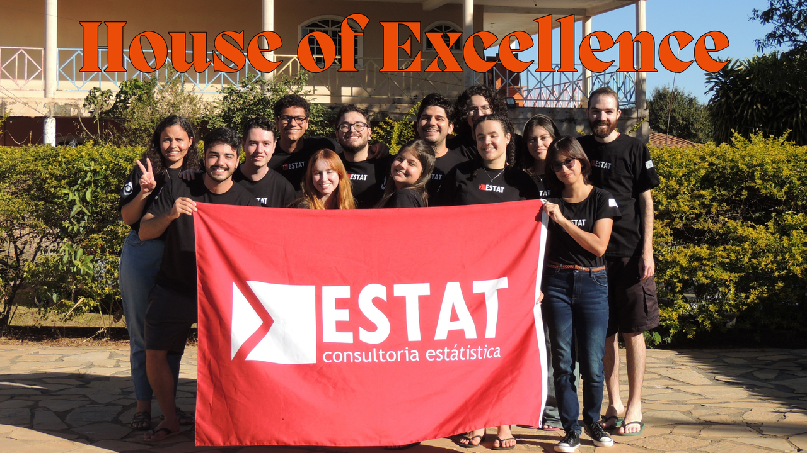
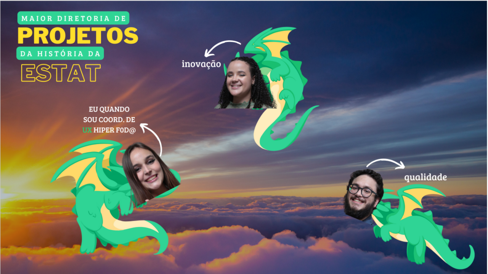

Esses guerreiros não cederam em nenhum momento da batalha e criaram diversas soluções criativas para ter sucesso nas corridas pro ENEJ e Prêmio Concentra, enquanto lutavam para migrar do Overleaf pro Quarto, atualizar, criar e documentar as jornadas, seja de relatório, dashboard ou consultoria. Estudaram metodologias ágeis e mudaram todos os conceitos da coleta de NPS através da implementação do WhatsApp Business. Com um clima muito favorável na diretoria e com processos bem implementados, a House of Excellence se voltou para resolver, principalmente, conflitos externos: - Quarto: aprendizado e adaptação. - Engajamento dos membros para alocação. - Responsabilidade dos alocados com projetos. - Gerenciamento de PowerBI. - Projetos com muitos retornos. - Conhecimento e interpretação do contrato. - Alinhamento das expectativas entre o que foi vendido e executado e o cliente.

### 3 ANOS (2025.1)

Aqui iniciamos a NOSSA história!

“Conheça-te a ti mesmo”, dentro do contexto organizacional essa frase é muito impactante, e isso não seria diferente para a nossa diretoria de ouro! Cada vez maior, Projetos vê a necessidade de se conhecer a fim de determinar sua identidade e como se apresentar para o mundo! Nesse sentido, surgiu a necessidade de criar o seu MVV!!

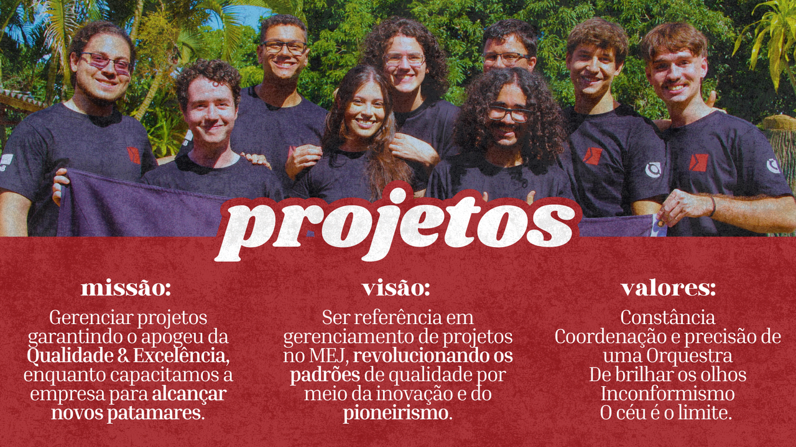

Dessa forma, foi dedicado tempo, esforço e muito carinho, para pensar em uma identidade para a diretoria que possa ser transcendental a essa gestão, que seja impactante e que defina o que é ser Projetos, o que é ser projetista e, acima de tudo, o que é ter o sangue #A11D21!

Nesse sentido, configurou-se uma missão alinhada com nossos objetivos de alcançar o ápice da Qualidade & Excelência nos produtos, com projetos de brilhar os olhos, à medida que procuramos novos desafios, e com esforço constante, ampliamos nossos conhecimentos a fim de alcançar novos patamares (o nosso Cluster 6)!

Nossa visão indica um futuro cada vez mais empreendedor, juntando nossa inovação e inconformismo para sermos pioneiros em desenvolver novos padrões de qualidade, tanto para a ESTAT quanto para todo o movimento! É ser visto como referência pelos nossos resultados e impactar as pessoas ao nosso redor. Para nós, o céu é o limite.

E é claro que isso não é um desafio que podemos fazer sozinhos, por isso precisamos do engajamento de todos, cada um segundo as suas habilidades e competências, com coordenação e precisão de uma orquestra.

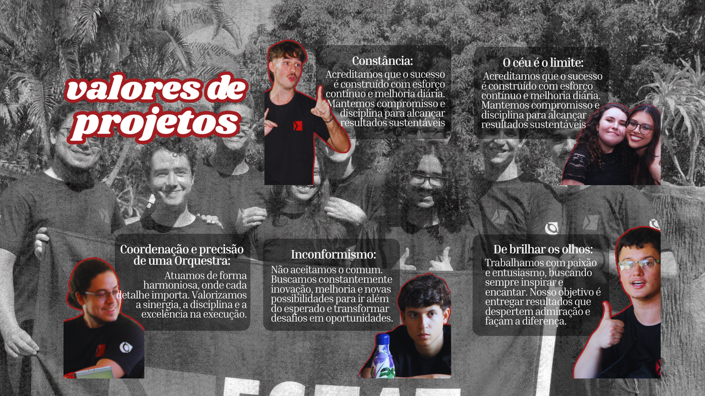

Alinhado a tudo isso, Projetos se engajou em desenvolver novos recursos para alcançar maior maturidade, documentando melhor os processos e focando em observar o passado a fim de conhecer sua história, erros, acertos e sonhos! Dessa forma, sem férias, mas com dois semestres que passam depressa, os P.H.I.N.E.A.S. e Febre (Projetistas Apoteóticos Inovadores NPS 10 Excelentes Ana Clara Supimpas e Febre).

E, nessa dinâmica, que cada vez mais existe a necessidade de se adaptar aos novos desafios e não é somente Projetos que passou por mudanças nesse semestre, a ESTAT reformulou seu MVV e mudou seu organograma.
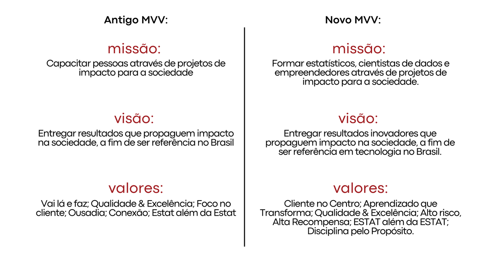
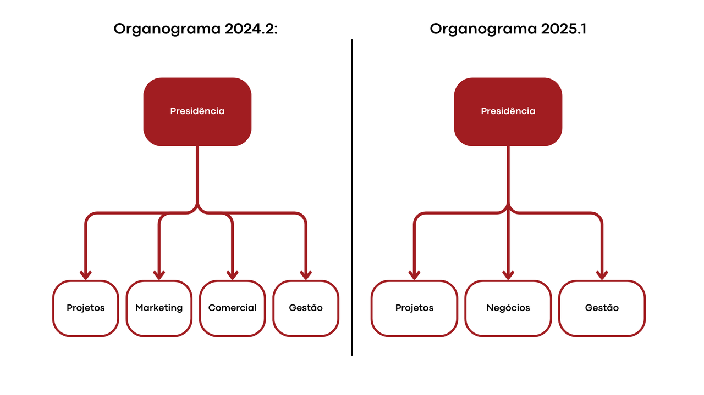
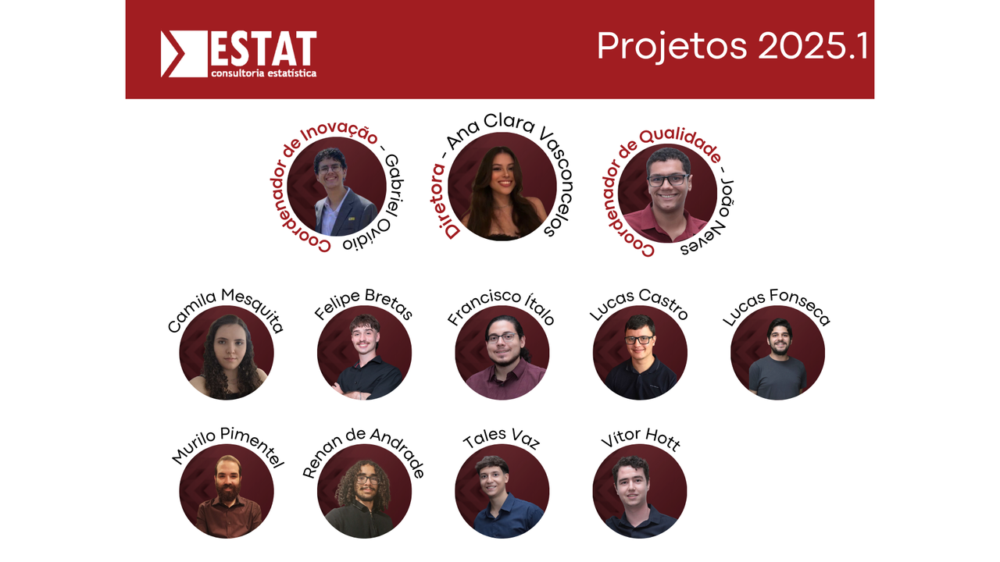

**Diretora**: Ana Clara Vasconcelos.\
**Coordenadores**: Gabriel Henrique Ovídio (Inovação) e João Vitor Neves (Qualidade).\
**Membros**: Camila Mesquita, Felipe Bretas, Francisco Ítalo, Lucas Castro, Lucas Fonseca, Murilo Pimentel, Renan de Andrade, Tales Vaz e Vítor Hott.

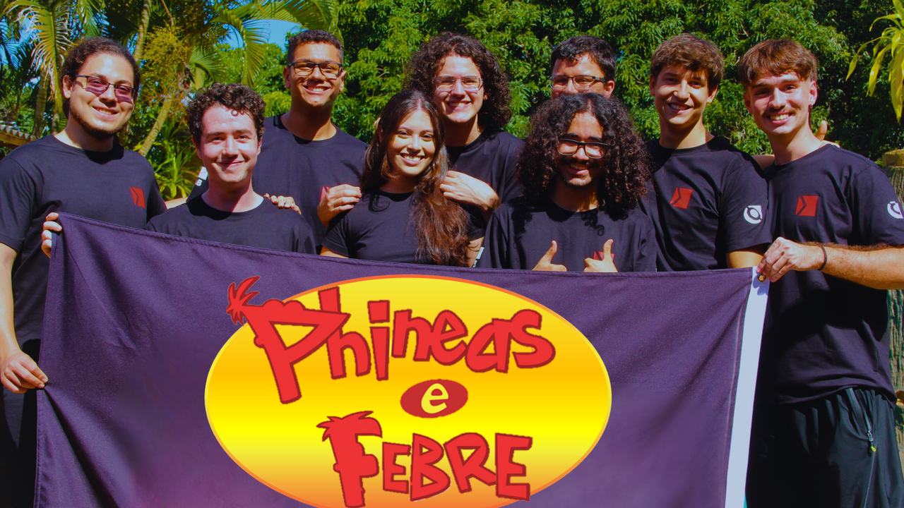

Com muitas atualizações das jornadas, criação de um manual de UX e jornada de capacitação, mudança no Processo Seletivo e Projeto Fantasma, explicação do que acontece dentro do Quarto, classificação e eleição de projetos de referência e muito mais, Projetos pode curtir um momento de muita inovação, mas como nem todos podem fazer uma coisa maluca demais, como passar um semestre sem dores, foram enfrentados alguns empecilhos: - Capacitação em Quarto. - Projetos chave. - Capacitações. - Pessoas com interesse em aprender sobre na planilha de alocação. - Valorização da vivência empresarial dentro da diretoria. - Interface com as outras diretorias. - Novo Pé da Rede.

------------------------------------------------------------------------

## Conclusão

A Diretoria de Projetos passou por diversas transformações desde sua criação. A adaptação ao longo dos anos permitiu que a equipe enfrentasse desafios e aprimorasse continuamente suas práticas. O compromisso com a gestão do conhecimento, processos estruturados e inovação são os pilares que sustentam essa trajetória e garantem seu futuro promissor.

------------------------------------------------------------------------

Este documento serve como um registro histórico e deve ser atualizado periodicamente para manter a memória organizacional e fortalecer a identidade da diretoria.
